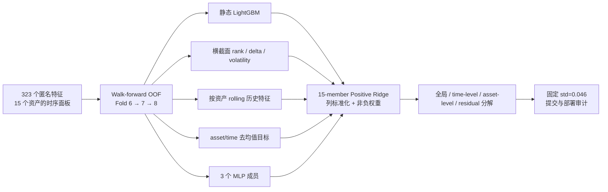

# Anonymous Multi-Asset Forecasting System

面向严格时序约束的匿名多资产预测系统：从千万级表格数据出发，建立 walk-forward 验证、结构化目标建模、时序与横截面特征、多模型去冗余集成，以及受限在线环境中的可复现交付链路。

> 这是项目封板后的作品集版本。官方数据、训练缓存、模型权重和 300 万行预测 CSV 不进入仓库；代码、固定配置、实验结论与复现说明完整保留。

## 项目概览

| 数据与约束 | 规模 |
|---|---:|
| 训练样本 | 13,227,692 行 |
| 公开测试样本 | 3,217,458 行 |
| 匿名资产 | 15 |
| 匿名特征 | 323 |
| 辅助 responder | 47 |
| 最终集成成员 | 15 |
| 最终推理约束 | 4 CPU / 12 GB RAM / 无 GPU / 无网络 |

任务要求预测每个 `time_id × asset_id` 的未来风险调整表现 `target`，评价指标为加权零均值 R²。训练、公开测试和最终评测按时间顺序组织，任何未来信息都不得用于当前预测。

## 最终方法



核心不是堆叠更大的单模型，而是构造归纳偏置不同的弱成员，并通过严格 OOF 预测、残余化和正约束 Ridge 控制冗余：

- **静态信号**：多个 LightGBM 基模型与长窗口模型；
- **横截面信号**：同一时点内对 323 个特征做 rank，再学习去除 time-level 后的目标；
- **纵向信号**：按资产维护历史窗口，构造 lag、rolling mean 与 delta；
- **结构化目标**：asset-demean、double-demean、asset-aware 目标；
- **非树模型信号**：三种 MLP 宽度与目标定义；
- **去冗余**：rank-delta、lag-5 delta 和 rolling-volatility 成员先对已有成员残余化，再进入 stack。

15-member 可复现版本在 Fold 7 / Fold 8 上分别达到 `0.002331 / 0.002453`，相对 8-member E3 基线提升 `+0.000143 / +0.000257`。最终公开提交在此基础上缩放 time-level 分量并保持总体标准差；完整结果与公私榜差异见 [结果与局限](docs/RESULTS_AND_LIMITATIONS.md)。

## 我完成的工作

- 设计并维护时间顺序严格的 walk-forward OOF 验证体系，区分本地机制验证、公开榜诊断和最终在线部署；
- 从静态 GBDT 推进到 rolling、横截面 rank、目标分解和 15-member ensemble；
- 建立成员相关性、leave-one-out、残差相关性、duplicate-control 与正约束 Ridge 审计，避免“低相关但无增量”的伪多样性；
- 对队友分支进行隔离 worktree 复现、行键对齐、哈希校验和完整链路打包；
- 完成 321 万行提交审计、严格时序 API runner、CPU/内存约束下的部署验证；
- 系统记录失败方向，包括 residual NN、TCN/GRU、panel Transformer、图时序模型、权重代理与 public regime 迁移失败，并将其转化为验证纪律和工程规则。

## 仓库结构

```text
.
├── configs/                  # 冻结的模型与最终校准配置
├── docs/                     # 架构、方法、实验演化、结果与深度复盘
├── reproduction/             # 0.0039380 脚本与冻结的上游源码快照
├── src/quant_competition/    # 指标、校准、Positive Ridge 可复用实现
├── tests/                    # 不依赖竞赛数据的单元测试
└── .github/workflows/        # 轻量 CI
```

## 快速验证

```bash
python -m venv .venv
source .venv/bin/activate
pip install -r requirements.txt
pip install -e .
pytest -q
```

完整重建需要官方 parquet 数据、冻结的上游分支和 GPU 环境。仓库不分发数据或大体积产物；具体步骤、环境版本与预期哈希见 [复现说明](docs/REPRODUCIBILITY.md) 和 [reproduction/README.md](reproduction/README.md)。

## 结果应如何理解

项目把早期公开结果提升约 **30.7%**，并产出可逐字节重建的 15-member 版本；但最终隐藏时段表现显著低于公开时段。这不是应被隐藏的细节，而是项目最重要的结论：非平稳时序任务中，公开榜最优、离线最优和真正未来泛化并不是同一个目标。

因此本仓库同时保留：

1. 可复现的成功链路；
2. 公开与隐藏时段的真实差异；
3. 失败实验和被否定的假设；
4. 对未来项目更严格的验证与部署改进方案。

## 文档

- [项目完整复盘与简历材料](docs/PROJECT_RETROSPECTIVE_CN.md)
- [数据、任务与规则](docs/DATA_AND_RULES.md)
- [模型架构](docs/ARCHITECTURE.md)
- [研究与验证方法](docs/METHODOLOGY.md)
- [从 baseline 到最终版本](docs/EXPERIMENT_TIMELINE.md)
- [结果、风险与局限](docs/RESULTS_AND_LIMITATIONS.md)
- [复现与制品边界](docs/REPRODUCIBILITY.md)
- [English overview](README_EN.md)

## 数据与许可

竞赛数据与官方材料归主办方所有，不包含在本仓库中。仓库代码以 MIT License 发布；团队协作与第三方边界见 [NOTICE.md](NOTICE.md)。
