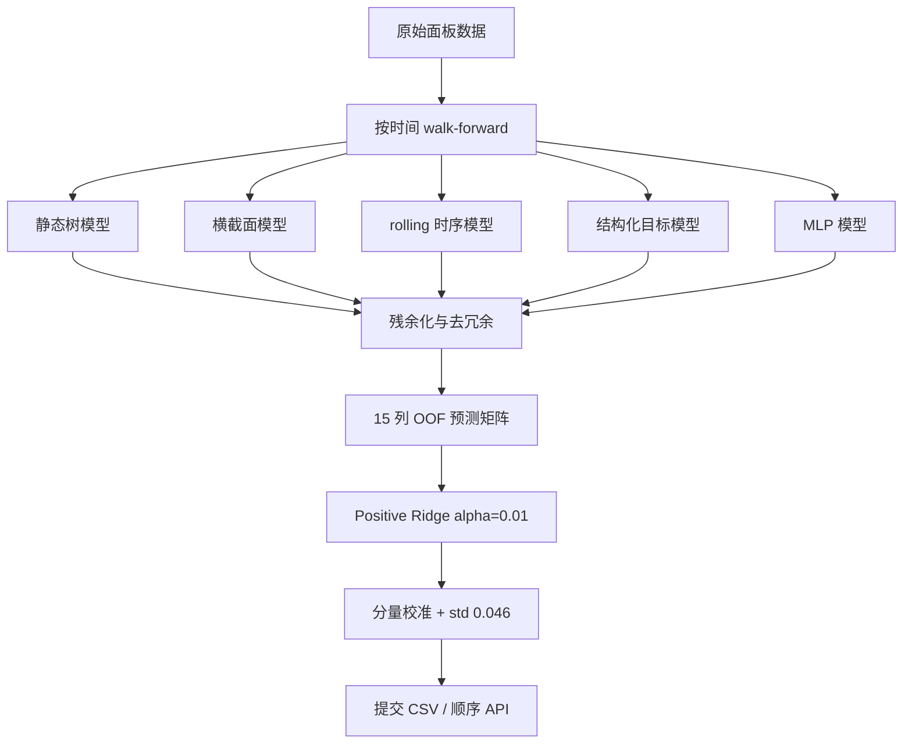

# 模型架构

## 总体结构



## 15 个成员

| 类别 | 成员 | 作用 |
|---|---|---|
| 基础组合 | `factor` | `(final + L88) / 2`，保留共同稳定方向 |
| 基础组合 | `contrast` | `final - L88`，暴露两个主预测器的差异 |
| 整体水平 | `level_pred` | 预测同一 `time_id` 的整体 target level |
| 时序 | `rolling_v1` | 每个资产的 lag、rolling mean 和 delta |
| 横截面 | `cs_rank` | 323 特征逐时点排名后预测 time-demeaned target |
| 长窗口 | `model_c_long` | 全历史窗口的 time-demeaned LightGBM |
| 横截面变化 | `csrd_resid` | lag-1 rank-delta，并对 `cs_rank` 残余化 |
| 横截面变化 | `csrd5_resid` | lag-5 rank-delta，并对 lag-1 delta 残余化 |
| 横截面波动 | `csrv_resid` | rolling-volatility rank，并对前三类横截面成员回归残余化 |
| 资产目标 | `asset_demean` | 预测 target 减去过去资产均值 |
| 双重去均值 | `double_demean` | 同时移除 asset-level 和 time-level |
| 资产感知 | `double_demean_assetaware` | 在双重去均值模型中加入类别型 `asset_id` |
| 神经网络 | `mlp_ad` | MLP 学习 asset-demeaned target |
| 神经网络 | `mlp_member` | MLP 学习 double-demeaned target |
| 神经网络 | `mlp_deep` | 更宽的 MLP 学习 double-demeaned target |

树模型主要使用 LightGBM。三个 MLP 使用 BatchNorm、ReLU、dropout 0.3、加权 MSE、Adam、余弦学习率和梯度裁剪。

## 为什么不是一个更大的模型

早期实验显示，继续扩大单个 GBDT 或神经网络并不会稳定提升未来 fold。真正有效的增益来自不同归纳偏置：

- raw feature 模型擅长静态非线性；
- rank 模型对同一时间的相对位置敏感；
- rolling 模型利用同一资产过去的状态；
- demeaned target 模型把整体 level 与横截面 deviation 分开；
- MLP 提供与树模型不同的函数形状。

单个成员可以很弱，只要其增量信号在未来 fold 稳定且未被现有 stack 吸收，就可能有价值。

## Positive Ridge

每个成员先除以其训练集 population standard deviation，再拟合：

```text
Ridge(alpha=0.01, positive=True, fit_intercept=False)
```

然后把系数除回原始尺度。正约束避免弱信号环境中出现不稳定的多空抵消；L2 正则抑制高度相关成员的权重爆炸。最终生产系数和成员顺序冻结在 [`reproduction/manifest.json`](../reproduction/manifest.json)。

## 最终输出校准

基础 15-member 预测被拆成：

```text
prediction = global_mean + time_level + asset_level + residual
```

可复现锚点不改变分量，仅保持总体均值并将 population std 调整为 `0.046`。最终公开最好版本将 `time_level` 乘以 `0.8`，其余分量保持不变，再恢复总体 std `0.046`。实现见 [`calibration.py`](../src/quant_competition/calibration.py)，冻结参数见 [`final_public_calibration.json`](../configs/final_public_calibration.json)。

## 在线推理

部署阶段不能一次读取完整未来测试集。rolling 成员必须维护每个资产的历史 buffer：

1. 收到当前 `time_id` 的 15 个资产特征；
2. 只用过去 buffer 和当前特征构造 lag/rolling/delta；
3. 生成所有成员预测并 stack；
4. 返回当前批次预测；
5. 将当前特征写入历史状态。

这保证任何时点都不会读取未来特征。由于完整 15-member 在线制品没有全部保真保存，最终私榜使用经过 A/B 验证的较简化 fallback；这是公私榜差异的重要工程背景之一。
